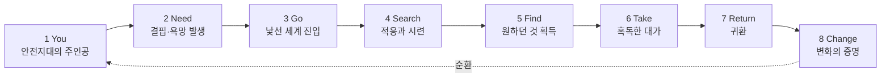

# F1. 전개(스토리 구조) 분류

> 대본의 **뼈대**를 고르는 문서. 분석할 때는 "이 영상이 어떤 뼈대를 쓰는가"를 판정하고,
> 생성할 때는 여기서 뼈대 1개를 골라 [[P3_신규대본_생성프롬프트]]에 넣는다.
> REF 노트의 frontmatter `structure_types`에는 반드시 아래 **enum 값 그대로** 쓴다 (검색 일관성).

## enum 목록 (frontmatter용)

`하몬서클8` `기승전결4` `3막구조` `액자식` `에피소드체인` `클리프행어체인` `카운트다운리스트` `PAS` `AIDA` `옴니버스병렬` `떡밥회수루프` `문답디베이트` `타임라인연대기`

---

## 1. 하몬서클8 — 스토리형 롱폼의 기본 뼈대

댄 하몬의 Story Circle. 25~35분 사연/각색 롱폼에 최적 (senior-story-longform 스킬이 이미 사용).

**구운몽 원작 매핑 (검증용 예시)**
| 단계 | 구운몽 |
|---|---|
| 1 You | 연화도량의 촉망받는 성진 |
| 2 Need | 팔선녀를 만나 속세 욕망 자각 |
| 3 Go | 벌로 양소유로 환생 |
| 4 Search | 과거길 — 인연·시험의 연속 |
| 5 Find | 장원급제, 2처 6첩, 부귀영화 |
| 6 Take | 인생의 허무 자각 |
| 7 Return | 꿈에서 깸 (액자 복귀) |
| 8 Change | 깨달음 — 성진의 성불 |

- 리텐션 포인트: 4단계(시련)를 잘게 쪼개 미니 위기를 반복 배치. 6단계 직전이 이탈 최다 구간 → 여기에 최대 반전.

## 2. 기승전결4 / 3막구조
- 기승전결: 10분 내외 단편 사연, 참교육 쇼츠 확장판에 적합. 전(반전)의 위치 = 전체의 60~70% 지점.
- 3막구조: 설정(25%) → 대립(50%, 중간에 미드포인트 반전) → 해결(25%). 실화 다큐·사건 해설에 적합.

## 3. 액자식 — 구운몽 영상이 쓰는 상위 프레임
바깥 이야기(해설자·현재)가 안쪽 이야기(본편 스토리)를 감싼다.
- 공식: **[바깥: 통념 전복 해설 3분] → [안: 극화된 본편 90%] → [바깥: 회수·다음편 예고]**
- 지식+스토리 하이브리드 채널의 핵심 구조. 해설자가 "이건 사실 X였다"를 먼저 선언하고 본편이 그 증거가 된다.
- 적합: 스토리각색형, 사건해설형. 주의: 바깥 이야기가 5분을 넘으면 이탈.

## 4. 에피소드체인 (수집형 엔진)
미니 아크(만남 → 시험/과시 → 획득 → 다음 떡밥)를 반복하며 각 아크의 끝이 다음 아크의 예고가 된다.
- 구운몽 본편: 계섬월 아크 끝에 "적경홍·정경패 추천" → 다음 아크 떡밥. 하렘·먼치킨 웹소설의 표준 엔진.
- 사연 롱폼에도 적용 가능: 인물 대신 "사건"을 수집 (시집살이 사건1→2→3, 각 사건 끝에 다음 사건 암시).

## 5. 클리프행어체인 (시리즈 분할)
챕터/편 끝을 항상 미해결 질문으로 끊는다. 구운몽 1편 엔딩 "그럼 파혼을 시켜야겠다" = 교과서적 사례.
- 규칙: 끊는 지점 = 새 갈등이 **선언된 직후**, 해소 **직전**. 다음 편 첫 30초에 즉시 회수.

## 6. 카운트다운리스트 (정보형 기본)
N가지를 10→1 역순으로. senior-money-info 스킬의 기본 구조.
- 리텐션 장치: "1위는 마지막에", 중간중간 "3위는 대부분 모릅니다" 예고.
- 각 항목 내부는 미니 PAS로: 문제 → 방치 시 손해 → 해결(신청 방법).

## 7. PAS / AIDA (정보·설득형)
- PAS: Problem(문제 공감) → Agitate(방치하면 악화) → Solution(해결책). 복지·연금·건강 정보에 최적.
- AIDA: Attention → Interest → Desire → Action. 상품·서비스 소개, 광고형.

## 8. 옴니버스병렬
독립된 짧은 썰 3~5개를 하나의 테마로 묶음. 각 썰은 기승전결4. 괴담 모음, 실화썰 모음.

## 9. 떡밥회수루프 (오픈 루프)
훅에서 던진 질문을 일부러 안 풀고 중반까지 끌고 간다. 여러 개를 겹치면(루프 중첩) 이탈이 급감.
- 구운몽 예: "왜 350년간 인기였나" → 3분에 "웹소설이라서"로 1차 회수 → "정말?"은 본편 전체로 2차 회수.

## 10. 문답디베이트 / 타임라인연대기
- 문답디베이트: 대립 2진영의 주장 교차 (jp-money-thread 스킬의 스레드 논쟁 구조). 댓글 참전 유도력 최강.
- 타임라인연대기: 연도·시간 순 전개. 인물 일대기, 사건 정리. 안정적이지만 반전 설계 필수.

---

## 선택 가이드 (생성 시)

| 목표 | 1순위 | 2순위 |
|---|---|---|
| 25분+ 사연/각색 롱폼 | 하몬서클8 | 액자식 + 에피소드체인 |
| 시리즈로 쪼개기 | 클리프행어체인 | 에피소드체인 |
| 정보·혜택 전달 | 카운트다운리스트 | PAS |
| 댓글 참전 유도 | 문답디베이트 | 떡밥회수루프 |
| 10분 단편 | 기승전결4 | 옴니버스병렬 |

> 실전은 거의 항상 **조합**이다. 구운몽 영상 = 액자식(상위) + 에피소드체인(본편) + 클리프행어체인(시리즈) + 떡밥회수루프(인트로).
