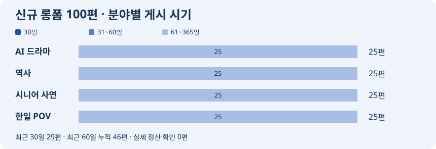

# 롱폼 100편 썸네일 대시보드

[AI 드라마 25편](#ai-drama) · [역사 25편](#history) · [시니어 사연 25편](#senior) · [한일 POV 25편](#pov) · [이전 60편](story-pov-dashboard.md)

**2026-11-27 KST** · 이전 롱폼 대시보드에 없는 100편 · 최근 30일 29편 · 최근 60일 누적 46편 · 1년 이내 100편. 항목은 분야별 누적 조회수 높은 순이며, 썸네일이나 제목을 누르면 YouTube 원본이 열립니다.

**누적 광고수익 추정: 공개 조회수 ÷ 1,000 × 2,000원.** 500만 원 추정 기준 250만 조회 이상 3편 · **실제 정산 확인 0편**. 광고 단가·시청국·수익화 여부는 미확인입니다. 광고 외 수익과 제작비는 반영하지 않았습니다. 3분 초과, 비라이브. 게시일은 시간대가 제공된 경우 KST로 환산했습니다.

## AI 드라마 · 25편

AI 드라마와 AI 단편·장편 본편. 제목·설명에 제작에 AI를 사용했다는 표기가 있거나 작품별 출처로 확인한 경우를 분류했습니다. 전편을 자동 생성했다는 뜻은 아닙니다.

<table>
<tr><td width="33%" valign="top"> <a href="https://www.youtube.com/watch?v=6pbhGtHRTwA"><strong>THE LOST KIND | FULL MOVIE | 4K Epic Dark Fantasy Film (Complete Story)</strong></a> VeylornStudios · 2026-11-14 · 30일 108:03 · 조회 10,415,813회 <strong>2,083만 원</strong> 추정 설명에 AI 보조 제작 명시</td><td width="33%" valign="top"> <a href="https://www.youtube.com/watch?v=NLAZubEa6X4"><strong>WOODNUTS | Sci-Fi Short Film (Cosmic Horror)</strong></a> Gossip Goblin · 2025-12-27 · 61~365일 10:41 · 조회 9,529,767회 <strong>1,906만 원</strong> 추정 원본 #aivideo · <a href="https://aifilmhistory.org/entry/woodnuts">작품별 AI 제작 출처</a></td><td width="33%" valign="top"> <a href="https://www.youtube.com/watch?v=31-p_UcMgOs"><strong>Then Came The Rot | The Aethernal Act II | Dark Fantasy Movie 4K</strong></a> Aethernal Pictures · 2026-11-22 · 30일 19:49 · 조회 3,686,602회 <strong>737만 원</strong> 추정 설명에 AI 도구 공개</td></tr>
<tr><td width="33%" valign="top"> <a href="https://www.youtube.com/watch?v=C3TFFxeFReQ"><strong>Surreal AI Film • A Very Unusual Town | The Quiet Road of Returning Sheep (4K)</strong></a> Walter AI Art · 2026-03-22 · 61~365일 4:05 · 조회 1,883,996회 <strong>377만 원</strong> 추정</td><td width="33%" valign="top"> <a href="https://www.youtube.com/watch?v=-1iJob_X-Rk"><strong>Zombie Robots | Sands of Steel (2026) | AI Short Film by Unbox14 Group</strong></a> Unbox14 | Creative AI FilmMaking Studio · 2026-10-22 · 31~60일 9:27 · 조회 1,524,899회 <strong>305만 원</strong> 추정</td><td width="33%" valign="top"> <a href="https://www.youtube.com/watch?v=EaTvBF1I6ZQ"><strong>What Remains | Short Film |  🏆  Award Winner - AI INTERNATIONAL FILM FESTIVAL (KCAIF)</strong></a> Lucas Cinematic Studio · 2026-05-25 · 61~365일 20:21 · 조회 960,293회 <strong>192만 원</strong> 추정</td></tr>
<tr><td width="33%" valign="top"> <a href="https://www.youtube.com/watch?v=51tomKplZ2E"><strong>Two Weeks at Grandma&#39;s House Turned Into Total Chaos! | Ai Nigerian Comedy Movie</strong></a> Wendy&#39;s AI Movies · 2026-11-13 · 30일 9:49 · 조회 819,258회 <strong>164만 원</strong> 추정</td><td width="33%" valign="top"> <a href="https://www.youtube.com/watch?v=e5fFWS15coY"><strong>천군 : 병자호란 [통합편 쿠키 포함]</strong></a> AI박스 · 2026-07-12 · 61~365일 87:08 · 조회 634,936회 <strong>127만 원</strong> 추정 AI 역사 판타지 · 실제 역사 기록이 아님</td><td width="33%" valign="top"> <a href="https://www.youtube.com/watch?v=uJMg6R92ErY"><strong>God and AGI Walk Into A Bar | AI Short Film</strong></a> The Red Shift Scrolls · 2026-11-13 · 30일 13:53 · 조회 599,159회 <strong>120만 원</strong> 추정</td></tr>
<tr><td width="33%" valign="top"> <a href="https://www.youtube.com/watch?v=KQ9BvfMwXYQ"><strong>OTTO |  Higgsfield Global Film Festival | AI Short Film</strong></a> Hasbroki · 2026-09-15 · 61~365일 6:24 · 조회 568,478회 <strong>114만 원</strong> 추정</td><td width="33%" valign="top"> <a href="https://www.youtube.com/watch?v=0XyIGiUqhMs"><strong>The Chronicles of Bone: The Last Assassin | Dark Fantasy Full AI Film</strong></a> When Crowns Bleed · 2026-10-03 · 31~60일 32:58 · 조회 518,374회 <strong>104만 원</strong> 추정</td><td width="33%" valign="top"> <a href="https://www.youtube.com/watch?v=MIgZnq8txRU"><strong>The Wolf-Born Queen 👑🐺 | Full Fantasy Movie HD | AI Fantasy Film</strong></a> History Dormant · 2026-10-21 · 31~60일 28:13 · 조회 502,353회 <strong>100만 원</strong> 추정</td></tr>
<tr><td width="33%" valign="top"> <a href="https://www.youtube.com/watch?v=Gy93gzllD4I"><strong>The Next Shift | AI Short Film | #SpecialForAAIFF</strong></a> ИИчница | Нейросети и ИИ · 2026-09-07 · 61~365일 3:05 · 조회 481,926회 <strong>96만 원</strong> 추정</td><td width="33%" valign="top"> <a href="https://www.youtube.com/watch?v=Fcx-UG7YBlE"><strong>Surreal AI Film • A Small Van, A Whole World of Family (4K)</strong></a> Velor AI Art · 2026-04-13 · 61~365일 9:58 · 조회 452,053회 <strong>90만 원</strong> 추정</td><td width="33%" valign="top"> <a href="https://www.youtube.com/watch?v=EJNhFARaxKA"><strong>2100 — Beyond the Horizon | A Utopian AI Short Film</strong></a> The Flo Factory · 2025-12-30 · 61~365일 10:33 · 조회 420,957회 <strong>84만 원</strong> 추정</td></tr>
<tr><td width="33%" valign="top"> <a href="https://www.youtube.com/watch?v=P6y6bITmn08"><strong>In Service of the Realm | Seedance AI Fantasy Short Film (2026)</strong></a> Lennard Smith · 2026-11-17 · 30일 15:50 · 조회 308,264회 <strong>62만 원</strong> 추정</td><td width="33%" valign="top"> <a href="https://www.youtube.com/watch?v=GQCQ-4aty8Q"><strong>The Bridge — AI Short Film | Higgsfield Festival</strong></a> Mike de Laat · 2026-09-15 · 61~365일 11:09 · 조회 260,787회 <strong>52만 원</strong> 추정</td><td width="33%" valign="top"> <a href="https://www.youtube.com/watch?v=kmStSog5aaI"><strong>She Married the Man Who Hated Her | An AI Historical Romance Film 🎞️</strong></a> RUTHERMONT · 2026-10-30 · 30일 7:02 · 조회 250,739회 <strong>50만 원</strong> 추정</td></tr>
<tr><td width="33%" valign="top"> <a href="https://www.youtube.com/watch?v=_glVBsCNbMU"><strong>MAKE BELIEVE - AI Short Film - Higgsfield Global Film Festival 2026</strong></a> Montlouis Mane · 2026-09-15 · 61~365일 13:20 · 조회 250,693회 <strong>50만 원</strong> 추정</td><td width="33%" valign="top"> <a href="https://www.youtube.com/watch?v=9rnlV8F9wcE"><strong>THE ORYTH | An AI Sci-Fi Short Film in 4K</strong></a> Reverie · 2026-11-09 · 30일 11:59 · 조회 207,665회 <strong>42만 원</strong> 추정</td><td width="33%" valign="top"> <a href="https://www.youtube.com/watch?v=wCxDvzx-qhk"><strong>AI映画『flower — すべてはここに在る』国際映画祭受賞作</strong></a> AI映画監督 谷田裕紀 · 2026-01-03 · 61~365일 9:11 · 조회 197,699회 <strong>40만 원</strong> 추정</td></tr>
<tr><td width="33%" valign="top"> <a href="https://www.youtube.com/watch?v=UQDM-ZigvGo"><strong>The World&#39;s Most Realistic AI Film | Higgsfield Originals (2026)</strong></a> Higgsfield AI · 2026-09-29 · 31~60일 20:06 · 조회 196,304회 <strong>39만 원</strong> 추정</td><td width="33%" valign="top"> <a href="https://www.youtube.com/watch?v=VsRYr4tvJr8"><strong>The First Honest Day | Grand Prix-Winning AI Short Film (AAIFF 2026)</strong></a> Shestak · 2026-11-14 · 30일 20:15 · 조회 160,607회 <strong>32만 원</strong> 추정</td><td width="33%" valign="top"> <a href="https://www.youtube.com/watch?v=NKSvZYJm7I4"><strong>북한이 대선 토론 당일 미사일을 쐈다 | 2차 한국전쟁 [AI 단편 영화] 1막</strong></a> 한밤의 시네마 · 2026-11-15 · 30일 11:13 · 조회 108,070회 <strong>22만 원</strong> 추정 게시자: AI로 만든 가상 이야기</td></tr>
<tr><td width="33%" valign="top"> <a href="https://www.youtube.com/watch?v=1Ha2f5LfChQ"><strong>We Woke Something Up – The Full Movie | Complete Edition | AI Sci-Fi Horror Film</strong></a> Xyronth | AI Sci-Fi Cinema, Films &amp; Documentaries⁠ · 2026-11-05 · 30일 22:40 · 조회 87,916회 <strong>18만 원</strong> 추정</td></tr>
</table>

## 역사 · 25편

조선사·고대 문명·한국 근현대 생활사·쇼와 일본을 함께 담았습니다. 기록물, 회고 해설, 재현 영상은 구분해서 참고하세요.

<table>
<tr><td width="33%" valign="top"> <a href="https://www.youtube.com/watch?v=YfPUeVAhmfw"><strong>1시간이면 완벽 이해 조선왕조실록 1대부터 27대까지 몰아보기ㅣ건국부터 멸망까지 한 편으로 끝내기</strong></a> 한밤의 한국사 · 2026-06-30 · 61~365일 69:33 · 조회 1,204,560회 <strong>241만 원</strong> 추정</td><td width="33%" valign="top"> <a href="https://www.youtube.com/watch?v=cueYnOv11o0"><strong>自民党を動かした「昭和の女帝」辻トシ子…隠された権力者の謎に、岸田元首相ら歴代総理・総裁の証言で迫る【ドキュメンタリー前編】</strong></a> ダイヤモンド公式チャンネル · 2025-12-08 · 61~365일 50:30 · 조회 694,577회 <strong>139만 원</strong> 추정</td><td width="33%" valign="top"> <a href="https://www.youtube.com/watch?v=P9kog8MlGro"><strong>수은의 강이 흐르는 무덤 — 2천 년간 인류가 열지 못한 단 하나의 봉인 | 진시황릉</strong></a> 딥 호라이즌 · 2026-06-27 · 61~365일 20:53 · 조회 619,438회 <strong>124만 원</strong> 추정</td></tr>
<tr><td width="33%" valign="top"> <a href="https://www.youtube.com/watch?v=YGkHyXisLuk"><strong>이집트 최대의 미스터리 — 투탕카멘의 저주, 그 진짜 정체</strong></a> 딥 호라이즌 · 2026-07-31 · 61~365일 13:57 · 조회 607,624회 <strong>122만 원</strong> 추정</td><td width="33%" valign="top"> <a href="https://www.youtube.com/watch?v=xg2YU4_zonc"><strong>절세미인은 거짓말이었다 — 로마가 2천 년간 숨긴 클레오파트라의 진짜 얼굴 | 클레오파트라</strong></a> 딥 호라이즌 · 2026-07-20 · 61~365일 17:43 · 조회 484,857회 <strong>97만 원</strong> 추정</td><td width="33%" valign="top"> <a href="https://www.youtube.com/watch?v=4cPZ8aX7jA4"><strong>괴베클리 테페 — 농사도 짓기 전, 12,000년 전 인류는 왜 신전부터 세웠나</strong></a> 딥 호라이즌 · 2026-06-21 · 61~365일 19:22 · 조회 329,361회 <strong>66만 원</strong> 추정</td></tr>
<tr><td width="33%" valign="top"> <a href="https://www.youtube.com/watch?v=5DqTN4gm7R0"><strong>(90분 몰아보기) 우리가 몰랐던 기상천외한 조선의 뒷이야기 총정리 | 조선왕조실록 외전</strong></a> 설민석 Seol Min Seok · 2026-03-23 · 61~365일 92:30 · 조회 268,187회 <strong>54만 원</strong> 추정</td><td width="33%" valign="top"> <a href="https://www.youtube.com/watch?v=Sxs_FtvJc0g"><strong>60년 전 서울 지금과 비교하면 놀랍습니다｜Real 1960s Seoul</strong></a> 그땐그랬지 | Back Then Korea · 2026-07-06 · 61~365일 8:32 · 조회 167,678회 <strong>34만 원</strong> 추정</td><td width="33%" valign="top"> <a href="https://www.youtube.com/watch?v=eBFvo0ox9fY"><strong>궁궐까지 호랑이가 나타난 조선, 총도 없이 어떻게 잡았을까? | 궁금한 옛 이야기</strong></a> 궁금한 옛 이야기 · 2026-11-16 · 30일 40:48 · 조회 142,705회 <strong>29만 원</strong> 추정</td></tr>
<tr><td width="33%" valign="top"> <a href="https://www.youtube.com/watch?v=TopHjWhXf0o"><strong>여기가 포항이라고? 6070 눈물겹고 뜨거웠던 풍경 | Incredible Pohang 1960-70s</strong></a> 그땐그랬지 | Back Then Korea · 2026-07-21 · 61~365일 6:36 · 조회 127,163회 <strong>25만 원</strong> 추정</td><td width="33%" valign="top"> <a href="https://www.youtube.com/watch?v=xZykBjDpxqw"><strong>80 年代のワクワクが蘇る…タイムスリップ家族の昭和すぎる暮らし</strong></a> ママリ · 2026-05-16 · 61~365일 4:04 · 조회 105,256회 <strong>21만 원</strong> 추정 쇼와 생활 재현</td><td width="33%" valign="top"> <a href="https://www.youtube.com/watch?v=_sECtzM2QA0"><strong>【昭和30年】山の小さな駅に嫁いだ娘の一生｜駅の官舎の台所から、最後の列車を見送るまで</strong></a> 昭和の柱時計 · 2026-11-23 · 30일 15:19 · 조회 97,922회 <strong>20만 원</strong> 추정</td></tr>
<tr><td width="33%" valign="top"> <a href="https://www.youtube.com/watch?v=tAL1VrYTPKk"><strong>昭和50年代の家族の1日｜朝から夜まで、今とはこんなに違った</strong></a> 昭和の思い出日和チャンネル · 2026-09-22 · 61~365일 10:08 · 조회 96,936회 <strong>19만 원</strong> 추정</td><td width="33%" valign="top"> <a href="https://www.youtube.com/watch?v=nTyRFOdAX3c"><strong>【昭和40年】農家に嫁いだお嫁さんの1日｜今ならありえない？ 昭和の当たり前</strong></a> 昭和ルーティン · 2026-10-16 · 31~60일 8:31 · 조회 94,122회 <strong>19만 원</strong> 추정</td><td width="33%" valign="top"> <a href="https://www.youtube.com/watch?v=xWAVLU7I8rI"><strong>【昭和の日本】四畳半に家族４人で暮らすタガミさん一家！公営住宅の抽選に殺到する人々 | 一方、公営住宅を勝手に増築する人も【1966年】</strong></a> Japan’s Nostalgic Films · 2026-01-24 · 61~365일 3:41 · 조회 89,268회 <strong>18만 원</strong> 추정</td></tr>
<tr><td width="33%" valign="top"> <a href="https://www.youtube.com/watch?v=PCdA3I42MeI"><strong>조선시대 왕과 궁궐 속 사람들｜진짜 우리가 몰랐던 뒷이야기｜잠들기 전 듣는 3시간 30분 단편</strong></a> 스페셜스토리 · 2026-10-07 · 31~60일 209:22 · 조회 83,841회 <strong>17만 원</strong> 추정</td><td width="33%" valign="top"> <a href="https://www.youtube.com/watch?v=j1nJHbHJMC4"><strong>誰も、あの日が最後になるとは思わなかった。｜昭和45年から60年の記憶</strong></a> 昭和の帰り道 · 2026-11-04 · 30일 6:44 · 조회 82,275회 <strong>16만 원</strong> 추정 쇼와 회고 소재</td><td width="33%" valign="top"> <a href="https://www.youtube.com/watch?v=hOMOUINeGb0"><strong>【昭和の日本】貴重な終戦直後の映像！焼け跡で生活し配給を受け取る人々 そして23年後の高度経済成長に浮かれる人々 1968年の終戦記念日に「何か」を問いかけるニュース映像</strong></a> Japan’s Nostalgic Films · 2026-04-12 · 61~365일 5:32 · 조회 79,715회 <strong>16만 원</strong> 추정</td></tr>
<tr><td width="33%" valign="top"> <a href="https://www.youtube.com/watch?v=2PzIlfWCTow"><strong>원수의 잔에 술을 따른 왕, 적국 왕실의 조상이 된 왕 | 한국사 망국 왕족 이야기</strong></a> 역사아카이브 - History Archive KR · 2026-10-01 · 31~60일 83:23 · 조회 79,123회 <strong>16만 원</strong> 추정</td><td width="33%" valign="top"> <a href="https://www.youtube.com/watch?v=LmuZrhyX1-8"><strong>컬러로 되살린 1940~60년대 광주, 그 시절 충격적인 풍경 | Gwangju in Living Color</strong></a> 그땐그랬지 | Back Then Korea · 2026-07-08 · 61~365일 3:14 · 조회 78,702회 <strong>16만 원</strong> 추정</td><td width="33%" valign="top"> <a href="https://www.youtube.com/watch?v=R0wwJ1YLlV4"><strong>【昭和34年】炭鉱の町で暮らす12歳の少女の一生｜ボタ山のふもとから、町でただ1人の看護婦になるまで</strong></a> 昭和ルーティン · 2026-11-10 · 30일 15:18 · 조회 72,365회 <strong>14만 원</strong> 추정</td></tr>
<tr><td width="33%" valign="top"> <a href="https://www.youtube.com/watch?v=ptawKpQ7BT0"><strong>🌜잠잘때 듣는 조선왕조실록, 태조부터 순종까지 27명의 왕 이야기</strong></a> 썰빵 · 2026-11-05 · 30일 111:43 · 조회 66,990회 <strong>13만 원</strong> 추정</td><td width="33%" valign="top"> <a href="https://www.youtube.com/watch?v=IfWik__kTjw"><strong>7080 그 시절 만원 버스에서 &quot;오라이&quot; 외치던 버스 안내양들은 다 어디로 갔을까?</strong></a> 꼭꼬무 · 2026-06-22 · 61~365일 15:42 · 조회 35,678회 <strong>7만 원</strong> 추정</td><td width="33%" valign="top"> <a href="https://www.youtube.com/watch?v=Glmd4XlN-2o"><strong>【昭和４１年〜４５年】母が作ってくれた懐かしい定番の家庭料理５選「あの頃の昭和にタイムスリップ」「１９６６年〜１９７０年」</strong></a> あの頃の昭和チャンネル · 2026-03-19 · 61~365일 19:42 · 조회 32,213회 <strong>6만 원</strong> 추정</td></tr>
<tr><td width="33%" valign="top"> <a href="https://www.youtube.com/watch?v=1hXpazGhFAQ"><strong>【昭和37年】団地の2DK｜14年の暮らしと、忘れられない大雪の夜</strong></a> 昭和こよみ · 2026-11-23 · 30일 15:28 · 조회 22,571회 <strong>5만 원</strong> 추정</td></tr>
</table>

## 시니어 사연 · 25편

한국·일본의 가족 이야기, 황혼 관계, 은퇴·주거를 다룬 낭독 사례입니다. 실화 여부나 실제 시청자 연령은 확인하지 않았습니다.

<table>
<tr><td width="33%" valign="top"> <a href="https://www.youtube.com/watch?v=4LWUpU_9bbc"><strong>죽은 아내의 번호로 전화 건 재벌회장, 정체 모를 아이의 대답에 얼어붙는데.. | 노후사연 | 감동사연 | 사연라디오 | 오디오북</strong></a> 청춘봄날 · 2026-03-21 · 61~365일 97:14 · 조회 373,723회 <strong>75만 원</strong> 추정</td><td width="33%" valign="top"> <a href="https://www.youtube.com/watch?v=U1uF3N1wfzE"><strong>회장인줄 모르고 전재산으로 병원비 내준 가난한 여성 며칠뒤 벤츠가 나타나더니   ㅣ노후사연ㅣ감동사연ㅣ사연라디오ㅣ오디오북</strong></a> 노을꽃 피다 · 2026-11-01 · 30일 95:38 · 조회 270,173회 <strong>54만 원</strong> 추정</td><td width="33%" valign="top"> <a href="https://www.youtube.com/watch?v=ZGZiRVSsvok"><strong>상견례날 휠체어 탄 어머니를 무시하고 모욕한 시댁, 다음날 시댁회사 주인이 바뀌는데 | 노후사연 | 시니어사연 | 인생사연</strong></a> 인생의 뒷모습 · 2026-07-07 · 61~365일 105:23 · 조회 229,644회 <strong>46만 원</strong> 추정</td></tr>
<tr><td width="33%" valign="top"> <a href="https://www.youtube.com/watch?v=yb8N5XwaW1U"><strong>&quot;차 내왔으면 나가!&quot; 1200억 계약 중 하녀 취급받은 며느리. 하지만 그녀의 고향 인사에 68세 스웨덴 회장이 벌떡 일어나며 소리쳤다. &quot;누가 나가라 했나!&quot;ㅣ노후사연ㅣ감동사연</strong></a> The love of a stranger · 2026-10-14 · 31~60일 216:46 · 조회 151,599회 <strong>30만 원</strong> 추정</td><td width="33%" valign="top"> <a href="https://www.youtube.com/watch?v=dJErqmebSj4"><strong>【아내 없이, 장모님과 살게 됐습니다】 ㅣ실화사연ㅣ황혼연애ㅣ노후사연ㅣ오디오북ㅣ중년로맨스ㅣ인생드라마</strong></a> 월야사록 · 2026-09-21 · 61~365일 47:39 · 조회 120,512회 <strong>24만 원</strong> 추정</td><td width="33%" valign="top"> <a href="https://www.youtube.com/watch?v=_-IxfW--osQ"><strong>연금 150만원 받고 시작한 60대 노후, 1년만에 저지른 가장  실수!</strong></a> 낙엽소설 · 2026-09-11 · 61~365일 68:44 · 조회 96,120회 <strong>19만 원</strong> 추정</td></tr>
<tr><td width="33%" valign="top"> <a href="https://www.youtube.com/watch?v=Ajut2vXlrkE"><strong>기초생활수급자 벗어나고 싶어서 69살에 재혼했습니다. 하지만 1년후 저는 지금 고시원에 살고있습니다.</strong></a> 황혼의 독백 · 2026-09-21 · 61~365일 130:12 · 조회 95,296회 <strong>19만 원</strong> 추정</td><td width="33%" valign="top"> <a href="https://www.youtube.com/watch?v=iOSYfv1ZTDM"><strong>시골에 사는 여인, 남편과의 이별 후 마주한 마지막 인생의 선택… l 노후이야기ㅣ황혼사랑ㅣ인생지혜ㅣ감동실화 오디오북</strong></a> 여백의 온도 · 2026-10-13 · 31~60일 33:20 · 조회 90,603회 <strong>18만 원</strong> 추정</td><td width="33%" valign="top"> <a href="https://www.youtube.com/watch?v=BtkenhgFSpg"><strong>&quot;내일 당장 남자친구가 필요해요!&quot;식당에서 오열하던 가난한 여종업원! 뒤에 있던 백만장자가 듣고 건넨 파격적인 제안이 그녀의 인생을 완벽하게 뒤집었다!ㅣ노후사연ㅣ감동사연ㅣ사연라디오</strong></a> 한국 재벌의 세계 · 2026-11-10 · 30일 151:11 · 조회 75,657회 <strong>15만 원</strong> 추정</td></tr>
<tr><td width="33%" valign="top"> <a href="https://www.youtube.com/watch?v=maAmM_Wg98U"><strong>배려심 깊은 남자와 60살에 재혼했습니다 하지만 6개월뒤 지옥이 시작됬습니다ㅣ노후사연ㅣ오디오북ㅣ황혼이혼</strong></a> 황금 인생 라디오 · 2026-07-25 · 61~365일 96:47 · 조회 56,136회 <strong>11만 원</strong> 추정</td><td width="33%" valign="top"> <a href="https://www.youtube.com/watch?v=sLXIWnSyEUQ"><strong>각방 쓰자고 했더니 집에서 나가라는 남편, 64세 할머니는 이혼을 했고 1년 후 모든걸 잃습니다.</strong></a> 황혼의 독백 · 2026-10-11 · 31~60일 144:49 · 조회 50,083회 <strong>10만 원</strong> 추정</td><td width="33%" valign="top"> <a href="https://www.youtube.com/watch?v=LuHwyp1KCtw"><strong>《친구부부는 아내를 잃은나에게 큰힘을주었다》황혼사랑ㅣ노후사연ㅣ오디오북ㅣ실화사연ㅣ노후준비ㅣ인생사연ㅣ황혼연애ㅣ황혼사연ㅣ시니어로맨스ㅣ실제사연ㅣ중년연애ㅣ황혼이야기ㅣ라디오사연</strong></a> 노후사연 · 2026-09-09 · 61~365일 95:25 · 조회 47,939회 <strong>10만 원</strong> 추정</td></tr>
<tr><td width="33%" valign="top"> <a href="https://www.youtube.com/watch?v=wYy34Sh5JAg"><strong>「嫁に仕えるか、出て行くか」息子からの突然の”最後通告”。私は黙ってスーツケースを持ち…2週間後、届いた”通知”に家族は声を失った【シニアライフ】【60代以上の方へ】</strong></a> 仏壇の前で · 2026-01-11 · 61~365일 35:55 · 조회 43,662회 <strong>9만 원</strong> 추정</td><td width="33%" valign="top"> <a href="https://www.youtube.com/watch?v=RfnNSxpak4c"><strong>부자인 줄 알고 65살에 재혼 했습니다. 하지만 1년 후 전 재산을 잃었습니다.</strong></a> 황혼의 독백 · 2026-10-23 · 31~60일 303:18 · 조회 42,367회 <strong>8만 원</strong> 추정</td><td width="33%" valign="top"> <a href="https://www.youtube.com/watch?v=wJNJrRjAGoo"><strong>묵묵히 챙겨주던 사람과 61살에 재혼했습니다 그런데 3개월 뒤 모든 게 거짓말이었습니다ㅣ시니어사연ㅣ노후사연ㅣ오디오북ㅣ황혼이혼</strong></a> 인생반전드라마 · 2026-10-18 · 31~60일 67:26 · 조회 39,459회 <strong>8만 원</strong> 추정</td></tr>
<tr><td width="33%" valign="top"> <a href="https://www.youtube.com/watch?v=QDwKAm7WfUk"><strong>먼저 간 동생을 대신해 챙겨주었다.ㅣ황혼사랑ㅣ황혼연애ㅣ오디오북ㅣ결혼생활ㅣ실화ㅣ황혼재혼ㅣ중년의사랑ㅣ황혼이혼ㅣ부부관계</strong></a> 가면속정 · 2026-11-04 · 30일 62:18 · 조회 38,912회 <strong>8만 원</strong> 추정</td><td width="33%" valign="top"> <a href="https://www.youtube.com/watch?v=kSdTmKZlu20"><strong>【感動する話】離婚から23年後、元妻の訃報を聞き葬儀場を訪れた彼。しかし、弔問客を迎える双子の喪主を目にした瞬間衝撃で凍りいてしまう…。ㅣ老後の物語ㅣ感動エピソードㅣ朗読ラジオ</strong></a> [海外の感動的な話] · 2026-02-17 · 61~365일 98:07 · 조회 37,218회 <strong>7만 원</strong> 추정</td><td width="33%" valign="top"> <a href="https://www.youtube.com/watch?v=wMcQ4APmTOc"><strong>【友情】「毎週来て困る」と笑っていた私に、友人が返した一言。娘が近くにいる幸せと、会えない寂しさに気づく60代女性の心温まる物語【シニア女性・家族・朗読】</strong></a> シニアの心に寄り添うお話【朗読チャンネル】 · 2026-11-08 · 30일 13:55 · 조회 14,032회 <strong>3만 원</strong> 추정</td></tr>
<tr><td width="33%" valign="top"> <a href="https://www.youtube.com/watch?v=U0xG3d2a2NI"><strong>【老後の衝撃】60代で同時に退職した親友2人…10年後、一人は天国、一人は地獄へ。お金に困らない人が捨てたものとは？</strong></a> 家族の思い出 · 2026-06-09 · 61~365일 27:51 · 조회 11,505회 <strong>2만 원</strong> 추정</td><td width="33%" valign="top"> <a href="https://www.youtube.com/watch?v=_x_i9hEMad4"><strong>【シニア恋愛】マンションの上の階の女性と恋に落ちた60代の男性。</strong></a> 60歳からの人生 · 2026-10-25 · 31~60일 55:11 · 조회 10,827회 <strong>2만 원</strong> 추정</td><td width="33%" valign="top"> <a href="https://www.youtube.com/watch?v=nAfVofi3XIE"><strong>【60代】「ありがとう」を一度も言わない夫の末路。家事を捨てた妻が手に入れた“本当の自由”【老後】【シニア朗読】</strong></a> シニアの物語 人生これから。 · 2026-04-01 · 61~365일 46:08 · 조회 8,316회 <strong>2만 원</strong> 추정</td></tr>
<tr><td width="33%" valign="top"> <a href="https://www.youtube.com/watch?v=5DWAnUzPYxQ"><strong>재혼 대신 동거를 선택한 67세 할머니, 하지만 2년 후   뼈저리게 후회합니다</strong></a> 노년 비밀서재 · 2026-11-20 · 30일 50:57 · 조회 6,044회 <strong>1만 원</strong> 추정</td><td width="33%" valign="top"> <a href="https://www.youtube.com/watch?v=s18s-sQFQLU"><strong>「老後資金8000万で大丈夫」贅沢三昧をしていた74歳女性の末路</strong></a> 家族に隠された物語 · 2026-10-09 · 31~60일 88:26 · 조회 4,918회 <strong>1만 원</strong> 추정</td><td width="33%" valign="top"> <a href="https://www.youtube.com/watch?v=l7JXNArrNdk"><strong>「年金だけでは仕送りがないと生きてけない」仕送りがなくなった年金8万円、73歳女性の地獄の老後</strong></a> 家族に隠された物語 · 2026-11-22 · 30일 85:20 · 조회 4,372회 <strong>1만 원</strong> 추정</td></tr>
<tr><td width="33%" valign="top"> <a href="https://www.youtube.com/watch?v=SwvJt7u8Ojg"><strong>40년 직장 생활 끝난 날, 아내가 퇴직금 통장 옆에 내민 것</strong></a> 동네형아 · 2026-06-03 · 61~365일 18:16 · 조회 4,048회 <strong>1만 원</strong> 추정</td></tr>
</table>

## 한일 POV · 25편

현장 시점의 산책·드라이브·열차 영상입니다.

### 일본 POV · 13편

<table>
<tr><td width="33%" valign="top"> <a href="https://www.youtube.com/watch?v=vbbJ9K5ew0A"><strong>ゲリラ豪雨の新宿・レベル4 大雨危険警報 - Sudden Downpour in Tokyo: Level 4 Heavy Rain Warning【4K Japan Walk】</strong></a> umaaji Japan Walker · 2026-08-29 · 61~365일 65:18 · 조회 1,028,691회 <strong>206만 원</strong> 추정</td><td width="33%" valign="top"> <a href="https://www.youtube.com/watch?v=Gks5nUdrlGg"><strong>Kyoto, Japan Spring 4K 🌸 Tranquil Sakura Temples, Sacred Shrines &amp; Timeless Stillness</strong></a> Peaceful World 4K · 2026-02-19 · 61~365일 181:34 · 조회 972,875회 <strong>195만 원</strong> 추정</td><td width="33%" valign="top"> <a href="https://www.youtube.com/watch?v=cZhR365mLO4"><strong>Kyoto Dawn Drive ⛩️ / 8K 60fps HDR / Japanese Ambient Lofi</strong></a> Abao Vision · 2026-06-08 · 61~365일 111:55 · 조회 437,395회 <strong>87만 원</strong> 추정</td></tr>
<tr><td width="33%" valign="top"> <a href="https://www.youtube.com/watch?v=Pb4PZjPl-hk"><strong>Summer Train Ride in Rural Aizu, Japan 🌿 / 8K 60fps HDR / Relaxing Piano Music</strong></a> Abao Vision · 2026-09-10 · 61~365일 105:38 · 조회 375,005회 <strong>75만 원</strong> 추정</td><td width="33%" valign="top"> <a href="https://www.youtube.com/watch?v=FWPuZqFe5dI"><strong>2 Hours Walking Tour in Downtown Tokyo, Japan • 4K HDR</strong></a> 4K JAPAN · 2026-08-18 · 61~365일 134:00 · 조회 350,176회 <strong>70만 원</strong> 추정</td><td width="33%" valign="top"> <a href="https://www.youtube.com/watch?v=UsdxjQ8LJGE"><strong>Tokyo After Dark - Shinjuku Kabukicho Night Walk 4K HDR</strong></a> VIRTUAL JAPAN · 2026-03-22 · 61~365일 38:41 · 조회 347,257회 <strong>69만 원</strong> 추정</td></tr>
<tr><td width="33%" valign="top"> <a href="https://www.youtube.com/watch?v=Wm_1WhSPH30"><strong>Kyoto at 1:34 AM — 1 Hour Midnight Rain Before the Typhoon [4K 3D Binaural]</strong></a> Quiet Journey | K. Iwasaki · 2026-06-07 · 61~365일 62:45 · 조회 327,524회 <strong>66만 원</strong> 추정</td><td width="33%" valign="top"> <a href="https://www.youtube.com/watch?v=3-Y9D-pWNqo"><strong>White Winter Ride in Nagano / 8K 60fps HDR / Calm Piano + Natural Ambience</strong></a> Abao Vision · 2026-02-21 · 61~365일 58:38 · 조회 314,447회 <strong>63만 원</strong> 추정</td><td width="33%" valign="top"> <a href="https://www.youtube.com/watch?v=pXnsHG2nbu4"><strong>Walking Downstream in Western Mountains | Kyoto, Japan</strong></a> Ambient Exploration · 2025-12-08 · 61~365일 120:16 · 조회 210,108회 <strong>42만 원</strong> 추정</td></tr>
<tr><td width="33%" valign="top"> <a href="https://www.youtube.com/watch?v=cCVQXyJToiU"><strong>Tokyo Night Walk - Akihabara, Kanda - 4K HDR</strong></a> VIRTUAL JAPAN · 2026-10-04 · 31~60일 43:00 · 조회 194,832회 <strong>39만 원</strong> 추정</td><td width="33%" valign="top"> <a href="https://www.youtube.com/watch?v=6EfFtmAnFN4"><strong>Japan Night Walk – Real Osaka Nightlife | Temma | 4K HDR</strong></a> THE JAPAN WALK · 2026-10-07 · 31~60일 64:02 · 조회 162,596회 <strong>33만 원</strong> 추정</td><td width="33%" valign="top"> <a href="https://www.youtube.com/watch?v=40tHeRhNW-s"><strong>Walking in Morning Rain through Nakasendo Village | Gifu, Japan</strong></a> Ambient Exploration · 2026-10-07 · 31~60일 89:18 · 조회 62,262회 <strong>12만 원</strong> 추정</td></tr>
<tr><td width="33%" valign="top"> <a href="https://www.youtube.com/watch?v=XFsyS_2SDYs"><strong>4K Immersive virtual walking tour exploring the most scenic rural village &amp; countryside Gifu, Japan</strong></a> Journey Memoirs · 2026-11-02 · 30일 29:57 · 조회 3,548회 <strong>1만 원</strong> 추정</td></tr>
</table>

### 한국 POV · 12편

<table>
<tr><td width="33%" valign="top"> <a href="https://www.youtube.com/watch?v=E8DblOf8xvY"><strong>Seoul Rain Walk, Yongsan District | 4K Rain Sounds, Relaxing Ambience ASMR</strong></a> Walking On · 2026-07-17 · 61~365일 38:20 · 조회 65,582회 <strong>13만 원</strong> 추정</td><td width="33%" valign="top"> <a href="https://www.youtube.com/watch?v=p4v-aQPsBoU"><strong>Walking Seoul&#39;s Most Beautiful Autumn Alleys: Vibrant Ginkgo Tunnels &amp; Weekend Street Life 4K 60fps</strong></a> Seoul Walker · 2026-10-31 · 30일 93:39 · 조회 56,165회 <strong>11만 원</strong> 추정</td><td width="33%" valign="top"> <a href="https://www.youtube.com/watch?v=fzckrXp4zIg"><strong>[4K HDR] 3 Hours Seoul Night Walk: Myeongdong, Hangang Park &amp; Hongdae Sleep ASMR</strong></a> Seoul Walker · 2026-09-27 · 61~365일 183:42 · 조회 54,125회 <strong>11만 원</strong> 추정</td></tr>
<tr><td width="33%" valign="top"> <a href="https://www.youtube.com/watch?v=hs0wFXe3o6o"><strong>Seoul Walking Tour 4K | Myeongdong Christmas Preparations, Shopping &amp; Street Food | 화려한 명동 쇼핑 밤거리</strong></a> Seoul Walk · 2026-11-10 · 30일 52:18 · 조회 52,767회 <strong>11만 원</strong> 추정</td><td width="33%" valign="top"> <a href="https://www.youtube.com/watch?v=pSPNoKvElLM"><strong>[4K HDR] Seoul Night Walk 🌃 Yeouido Hangang Park | Autumn City Relaxing Sounds</strong></a> Seoul Walker · 2026-09-15 · 61~365일 54:20 · 조회 47,277회 <strong>9만 원</strong> 추정</td><td width="33%" valign="top"> <a href="https://www.youtube.com/watch?v=O0bGY8z9UCc"><strong>[4K HDR] Sunset to Night Walk along the Seoul City Wall | Naksan Park Evening</strong></a> Seoul Walker · 2026-09-06 · 61~365일 56:16 · 조회 46,451회 <strong>9만 원</strong> 추정</td></tr>
<tr><td width="33%" valign="top"> <a href="https://www.youtube.com/watch?v=mrBurXMkv10"><strong>[4K HDR] Christmas Magic Begins in Seoul: Breathtaking Media Facade &amp; Chilly Winter Walk</strong></a> Seoul Walker · 2026-11-07 · 30일 75:23 · 조회 42,299회 <strong>8만 원</strong> 추정</td><td width="33%" valign="top"> <a href="https://www.youtube.com/watch?v=XjkANgogal8"><strong>The Last Autumn Walk in Seoul Namsan Tower to Myeongdong | 2.5 Hours Sleep ASMR 4K 60fps</strong></a> Seoul Walker · 2026-11-16 · 30일 152:02 · 조회 27,788회 <strong>6만 원</strong> 추정</td><td width="33%" valign="top"> <a href="https://www.youtube.com/watch?v=Tb1I9DxYdzc"><strong>[Full Version]Seoul Walking Tour 4K | Gangnam, Sinsa-dong, Apgujeong | Korea Trendy City Walk | 강남거리</strong></a> Seoul Walk · 2026-06-27 · 61~365일 163:27 · 조회 19,012회 <strong>4만 원</strong> 추정</td></tr>
<tr><td width="33%" valign="top"> <a href="https://www.youtube.com/watch?v=0cbPAQlNduU"><strong>[South Korea] Seoul 4K Walking Tour | Jongno Pojangmacha, Ikseon-dong Hanok Village Night Walk</strong></a> ZEROBIG WALKING TOUR · 2026-08-16 · 61~365일 45:30 · 조회 9,031회 <strong>2만 원</strong> 추정</td><td width="33%" valign="top"> <a href="https://www.youtube.com/watch?v=6N2nKE0Wnug"><strong>[4K] Seoul Walking Tour, Insa-dong | Seoul Walk</strong></a> Walking On · 2026-11-09 · 30일 31:51 · 조회 6,739회 <strong>1만 원</strong> 추정</td><td width="33%" valign="top"> <a href="https://www.youtube.com/watch?v=HchJD1mCa0E"><strong>[South Korea] Seoul 4K Walking Tour | Jamsil · Itaewon · Jongno · Myeongdong, Christmas Night Walk</strong></a> ZEROBIG WALKING TOUR · 2026-11-23 · 30일 197:58 · 조회 4,817회 <strong>1만 원</strong> 추정</td></tr>
</table>
