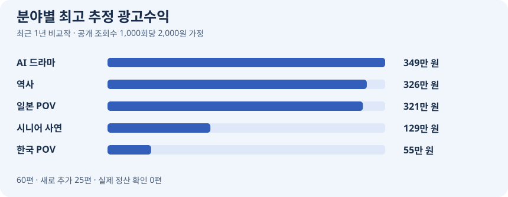

# 롱폼 탐색 대시보드: AI 드라마 · 역사 · 시니어 · 한일 POV

[AI 드라마](#ai-drama) · [역사](#history) · [시니어 사연](#senior) · [일본 POV](#japan-pov) · [한국 POV](#korea-pov)

**2026-11-27 KST 기준 · 최근 1년 롱폼 35편 (최근 30일 11편)** · 분야 안에서 누적 조회수·기준 추정액 높은 순. 썸네일을 누르면 유튜브 원본이 열립니다. 검색에서 확인한 표본이지 유튜브 전체 순위는 아닙니다.

**누적 광고수익 추정 = 공개 조회수 ÷ 1,000 × 2,000원.** 실제 정산과 시청자 연령 미확인. 500만 원 문턱은 250만 조회이며 이 표본에서는 해당 영상이 없습니다. 시청국·수익화 상태·제작비·권리·협찬은 추정에 반영하지 않았습니다. 게시일은 원본의 시간대가 있을 때 KST 환산, 날짜만 있으면 표기 일자 사용. 3분 초과, 라이브 제외.

## AI 드라마

포맷 비교: 8~9분 감정 중심 단편, 장편 세계관, 가족 갈등 연속극. AI 제작 표기는 해당 업로더 설명·제목에 근거하며 저작권 소유나 수익화 인증과는 다릅니다.

<table>
<tr><td width="33%" valign="top"> <a href="https://www.youtube.com/watch?v=zOS0oOeTO64"><strong>Surreal AI Film • The Quiet People By The Sea (4K)</strong></a> Walter’s Puppet Box · 2026-05-20 · 61~365일 조회 1,410,097회 · 7분 43초 <strong>282만 원</strong> · 광고수익 추정 AI 영화 표기</td><td width="33%" valign="top"> <a href="https://www.youtube.com/watch?v=gwJfa9-AMx4"><strong>BEYOND THE WORLD: BOOK OF LIFE | Full AI Movie 4K</strong></a> OVIS AI · 2026-09-01 · 61~365일 조회 1,378,943회 · 67분 50초 <strong>276만 원</strong> · 광고수익 추정 제작자 원작·AI 공개</td><td width="33%" valign="top"> <a href="https://www.youtube.com/watch?v=6D4_ZMnPx7I"><strong>BONE THRONE | AI Short Film Made with Seedance 2.0 &amp; Kling 3.0</strong></a> Lennard Smith · 2026-02-28 · 61~365일 조회 432,217회 · 5분 0초 <strong>86만 원</strong> · 광고수익 추정 Seedance·Kling 표기</td></tr>
<tr><td width="33%" valign="top"> <a href="https://www.youtube.com/watch?v=S9o3MzrYi7g"><strong>100% AI 제작 영화- 재난문자2 지하철 (영화제 수상작 Award-Winning Film)</strong></a> JJ플라이트 · 2026-02-26 · 61~365일 조회 397,804회 · 16분 40초 <strong>80만 원</strong> · 광고수익 추정 100% AI 제작 표기</td><td width="33%" valign="top"> <a href="https://www.youtube.com/watch?v=O_2-k4QjOs4"><strong>Walls Down | Part One - WLW  AI Short Film</strong></a> Reverie Lab ☂️ · 2026-11-02 · 30일 조회 158,139회 · 8분 55초 <strong>32만 원</strong> · 광고수익 추정 AI 단편 표기</td><td width="33%" valign="top"> <a href="https://www.youtube.com/watch?v=rBlleeiyS2k"><strong>【AI漫剧全集】母亲被拒门外，穷大哥一亮身份全场起立！《我回家那天，母亲不再需要看别人脸色》第1~60集#KK爱看#AI短剧#漫剧#家庭#伦理</strong></a> KK爱看 · 2026-11-21 · 30일 조회 150,483회 · 103분 56초 <strong>30만 원</strong> · 광고수익 추정 AI 만화 연속극 표기</td></tr>
<tr><td width="33%" valign="top"> <a href="https://www.youtube.com/watch?v=78tfn8HwoDw"><strong>FINDING ALEX (2026) | FULL AI MOVIE | BRITISH GANGSTER CRIME THRILLER</strong></a> P24 Pictures · 2026-10-15 · 31~60일 조회 71,429회 · 87분 39초 <strong>14만 원</strong> · 광고수익 추정 AI 장편 표기</td></tr>
</table>

## 역사

포맷 비교: 조선 왕조 몰아보기, 쇼와 생활사, 한 사람의 하루. AI 재현은 지역·시대 차이와 실제 사료를 구분해 표기하는 것이 좋습니다.

<table>
<tr><td width="33%" valign="top"> <a href="https://www.youtube.com/watch?v=bTyEi0vlugk"><strong>&quot;70분으로 보는 조선왕조실록 1대~27대 왕이야기&quot; 어른부터 어린아이까지 귀에쏙쏙 박히게 알려드립니다 |조선500년 |한국사 |조선역사 |조선왕조실록 |역사</strong></a> 이상한 역사학 · 2026-04-11 · 61~365일 조회 1,627,973회 · 71분 41초 <strong>326만 원</strong> · 광고수익 추정</td><td width="33%" valign="top"> <a href="https://www.youtube.com/watch?v=dI_N6yMFD84"><strong>昭和の年末年始 「人間じゃなくてケモノでした」　倒れる人が続出、肩が触れ合えばケンカ…　何もかもが熱過ぎました　／ （2025/12/19  OA）</strong></a> 福岡TNC ニュース · 2025-12-20 · 61~365일 조회 1,252,639회 · 8분 27초 <strong>251만 원</strong> · 광고수익 추정</td><td width="33%" valign="top"> <a href="https://www.youtube.com/watch?v=QXIxVJU0GI8"><strong>🌙성우 이지선 낭독 | 태평성대 성종 이야기 | 잘듣세</strong></a> 잘듣세 - 잘 때 듣는 세계사 · 2026-02-18 · 61~365일 조회 937,477회 · 53분 57초 <strong>187만 원</strong> · 광고수익 추정</td></tr>
<tr><td width="33%" valign="top"> <a href="https://www.youtube.com/watch?v=PQvfLnO9y5o"><strong>【昭和46年】長距離トラック運転手の1日｜今ならありえない？ 昭和の当たり前</strong></a> 昭和ルーティン · 2026-10-23 · 31~60일 조회 464,842회 · 11분 28초 <strong>93만 원</strong> · 광고수익 추정 AI 영상·내레이션 공개</td><td width="33%" valign="top"> <a href="https://www.youtube.com/watch?v=znnb8uSrTEo"><strong>昭和30年代の日本にタイムスリップ。AIで蘇る懐かしい四季</strong></a> Unknown World · 2026-11-03 · 30일 조회 241,990회 · 4분 57초 <strong>48만 원</strong> · 광고수익 추정 AI 시대 재현·창작</td><td width="33%" valign="top"> <a href="https://www.youtube.com/watch?v=TXg5Vbh-8j0"><strong>【昭和のマタギ】一度山に入れば何日も帰らない…熊を追う父ちゃんたちは、雪の山小屋で何を食べていたのか？</strong></a> あの日の食卓 · 2026-11-24 · 30일 조회 105,222회 · 15분 55초 <strong>21만 원</strong> · 광고수익 추정</td></tr>
<tr><td width="33%" valign="top"> <a href="https://www.youtube.com/watch?v=9B56vOew2oM"><strong>화려해 보이던 조선 중전의 하루, 왜 쉴 틈이 없었을까?</strong></a> 궁금한 옛 이야기 · 2026-11-24 · 30일 조회 78,154회 · 41분 31초 <strong>16만 원</strong> · 광고수익 추정</td></tr>
</table>

## 시니어 사연

포맷 비교: 황혼 관계·가족 갈등·노후 생활·일본어 낭독. 시니어 관심 소재로 선별했으며 실제 시청자 연령이나 사연의 실화 여부는 확인하지 않았습니다.

<table>
<tr><td width="33%" valign="top"> <a href="https://www.youtube.com/watch?v=0sWLcb_mJKE"><strong>쌍둥이 출산 날 남편 세상 떠난 후 재벌가 가정부로 갔더니, 그 집 사모님 곁의 회장을 본 순간 &quot;여..여보?“ㅣ노후사연ㅣ인생사연ㅣ감동사연ㅣ시니어사연ㅣ오디오북</strong></a> 해뜰날 · 2026-04-11 · 61~365일 조회 646,057회 · 107분 55초 <strong>129만 원</strong> · 광고수익 추정</td><td width="33%" valign="top"> <a href="https://www.youtube.com/watch?v=MxsbmB1K6Vc"><strong>요즘 똑똑한 60대들이 친구 안 만나고 집에만 있는 5가지 이유ㅣ노후인생ㅣ노년지혜ㅣ노년건강ㅣ무병장수ㅣ라디오ㅣ오디오북ㅣ인생무상</strong></a> 순간의기록 · 2025-12-18 · 61~365일 조회 517,824회 · 139분 24초 <strong>104만 원</strong> · 광고수익 추정</td><td width="33%" valign="top"> <a href="https://www.youtube.com/watch?v=3NGFcHcAjmk"><strong>35년을 산 마누라가 제 40년 친구와 살고 싶다고해서..저는 쿨하게 보내줬습니다.</strong></a> 시니어황금사연 · 2026-10-06 · 31~60일 조회 371,106회 · 41분 38초 <strong>74만 원</strong> · 광고수익 추정 AI 기반 구성·작가 검토 공개</td></tr>
<tr><td width="33%" valign="top"> <a href="https://www.youtube.com/watch?v=NfT21lqLrvE"><strong>우리 딸은 손님이고 넌 일꾼이지! 시어머니와 시누이에게 15년간 당하던 며느리, 칠순 잔칫날 앞치마를 벗었습니다. ㅣ노후사연ㅣ감동사연ㅣ사연라디오ㅣ오디오북</strong></a> Midu Hoang · 2026-11-10 · 30일 조회 121,937회 · 97분 7초 <strong>24만 원</strong> · 광고수익 추정 AI 재현·허구 공개</td><td width="33%" valign="top"> <a href="https://www.youtube.com/watch?v=BiWkQoqzfhM"><strong>“인사드리러 왔지, 하녀 노릇 하러 온 게 아니에요!” 예비 시어머니 앞에서 파혼을 선언하자 온 가족이 얼어붙었다! ㅣ노후사연ㅣ감동사연ㅣ사연라디오ㅣ오디오북</strong></a> 사연 한 편 · 2026-11-16 · 30일 조회 94,925회 · 141분 48초 <strong>19만 원</strong> · 광고수익 추정</td><td width="33%" valign="top"> <a href="https://www.youtube.com/watch?v=qGlmF4uY9SQ"><strong>【シニア恋愛】「耐えられる」と言ったのに、彼女の涙がすべてを語った。 黄昏の恋｜ラジオストーリー｜シ</strong></a> 60歳からの人生 · 2026-10-25 · 31~60일 조회 77,032회 · 76분 40초 <strong>15만 원</strong> · 광고수익 추정</td></tr>
<tr><td width="33%" valign="top"> <a href="https://www.youtube.com/watch?v=54YQmw0NDnU"><strong>며느리 눈치에 도망치듯 집을 나와 60살에 재혼했습니다. 하지만 지옥이 시작됐습니다.</strong></a> 황혼의 독백 · 2026-10-08 · 31~60일 조회 62,057회 · 212분 43초 <strong>12만 원</strong> · 광고수익 추정</td></tr>
</table>

## 일본 POV

포맷 비교: 시골 열차 전면 시점, 도쿄 빗길, 오사카 야간 거리. 소리·날씨·시간대가 다른 원본끼리 비교하세요.

<table>
<tr><td width="33%" valign="top"> <a href="https://www.youtube.com/watch?v=BaxN5j7pS9o"><strong>Rural Summer Train Ride in Hiroshima / 8K 60fps HDR / Calm Piano + Natural Ambience</strong></a> Abao Vision · 2026-03-08 · 61~365일 조회 665,564회 · 69분 35초 <strong>133만 원</strong> · 광고수익 추정</td><td width="33%" valign="top"> <a href="https://www.youtube.com/watch?v=axewALA2s_E"><strong>🇯🇵 OSAKA, JAPAN 4K WALKING TOUR - Dotonbori &amp; Amerikamura Shopping Distrct | 4K HDR - 60 fps</strong></a> World Wanderings: 4K Walking Tours · 2026-01-09 · 61~365일 조회 545,243회 · 154분 43초 <strong>109만 원</strong> · 광고수익 추정</td><td width="33%" valign="top"> <a href="https://www.youtube.com/watch?v=Whb_j5kk65o"><strong>【ASMR】Late-Night Tokyo in Heavy Rain: Walking Through the City After Dark | Japan 4K HDR</strong></a> 4K Ambient Walk · 2026-10-01 · 31~60일 조회 273,195회 · 62분 30초 <strong>55만 원</strong> · 광고수익 추정</td></tr>
<tr><td width="33%" valign="top"> <a href="https://www.youtube.com/watch?v=yP8xgs0kKz0"><strong>Rainy Tokyo Night Drive 🚗 / 8K 60fps HDR / Relaxing Piano Music</strong></a> Abao Vision · 2026-10-07 · 31~60일 조회 214,266회 · 158분 3초 <strong>43만 원</strong> · 광고수익 추정</td><td width="33%" valign="top"> <a href="https://www.youtube.com/watch?v=bzLidjRwpew"><strong>Osaka Halloween – The Wildest Night of the Year | Japan Walk | 4K HDR</strong></a> THE JAPAN WALK · 2026-11-01 · 30일 조회 104,293회 · 73분 16초 <strong>21만 원</strong> · 광고수익 추정</td><td width="33%" valign="top"> <a href="https://www.youtube.com/watch?v=Evf7RmPRCEI"><strong>【4K HDR】Shibuya Halloween 2026  | One of the World&#39;s Biggest Halloween Street Celebrations in Tokyo</strong></a> Travel at Home · 2026-11-02 · 30일 조회 103,439회 · 53분 18초 <strong>21만 원</strong> · 광고수익 추정</td></tr>
<tr><td width="33%" valign="top"> <a href="https://www.youtube.com/watch?v=ew1k1vd8yLw"><strong>【66年ぶりの新造車両で夕刻のことでんを往く!!】【4K60fps字幕付き前面展望】高松築港→琴電琴平 2000形 ことでん琴平線 Takamatsu ~ Kotohira. KOTODEN.</strong></a> Arkibk Train Aki （あき） · 2026-10-05 · 31~60일 조회 45,741회 · 63분 58초 <strong>9만 원</strong> · 광고수익 추정</td></tr>
</table>

## 한국 POV

포맷 비교: 한옥 눈길·서울 봄 산책·야간 거리·실내 동선. 일본 POV와 함께 장소 특성, 무대사 현장음, 걷는 속도를 비교하세요.

<table>
<tr><td width="33%" valign="top"> <a href="https://www.youtube.com/watch?v=5yPkgww3Prc"><strong>[4K]🇰🇷 Seoul Spring Walk 🌼🌸 A Beautiful Day &amp; Night in Trendy Neighborhoods (2026)</strong></a> Walking Alice · 2026-04-18 · 61~365일 조회 273,668회 · 57분 3초 <strong>55만 원</strong> · 광고수익 추정</td><td width="33%" valign="top"> <a href="https://www.youtube.com/watch?v=unY9hqu9bEk"><strong>SEOUL, South Korea 🇰🇷 Hongdae, the best district? | 4K Walking Tour</strong></a> Walking OZ · 2026-04-26 · 61~365일 조회 125,245회 · 94분 48초 <strong>25만 원</strong> · 광고수익 추정</td><td width="33%" valign="top"> <a href="https://www.youtube.com/watch?v=j2jNXrm3i5Y"><strong>[South Korea] Seoul 4K Walking Tour | Seosulla-gil · Cheonggyecheon · Euljiro · Myeongdong · Jongno</strong></a> ZEROBIG WALKING TOUR · 2026-09-02 · 61~365일 조회 114,331회 · 150분 29초 <strong>23만 원</strong> · 광고수익 추정</td></tr>
<tr><td width="33%" valign="top"> <a href="https://www.youtube.com/watch?v=TArU4_cwE6M"><strong>2 HOUR SNOWY NIGHT IN SEOUL 4K ASMR | Bukchon Hanok Village Walking Tour HDR</strong></a> Seoul Walker · 2026-01-14 · 61~365일 조회 79,523회 · 117분 48초 <strong>16만 원</strong> · 광고수익 추정</td><td width="33%" valign="top"> <a href="https://www.youtube.com/watch?v=w9NzP9y_hCw"><strong>［Itaewon 4K］Seoul Night Walk!! ~ 압도적 짜릿함 ~ 이태원 클럽 거리 ~~ !!</strong></a> Korenzo Tube · 2026-10-30 · 30일 조회 57,964회 · 34분 42초 <strong>12만 원</strong> · 광고수익 추정</td><td width="33%" valign="top"> <a href="https://www.youtube.com/watch?v=RakWomv6j_A"><strong>[4K HDR] 3 Hours Seoul Walk: Evening Rush Hour, Sunset Island &amp; Vibrant Nightlife [Sleep ASMR]</strong></a> Seoul Walker · 2026-10-10 · 31~60일 조회 46,987회 · 201분 39초 <strong>9만 원</strong> · 광고수익 추정</td></tr>
<tr><td width="33%" valign="top"> <a href="https://www.youtube.com/watch?v=eP7bZ3nj32E"><strong>Inside Seoul’s BRAND NEW Mall! Lotte Mall Bellytown Night Walk 4K Korea</strong></a> Stroll Wander · 2026-11-22 · 30일 조회 5,090회 · 44분 40초 <strong>1만 원</strong> · 광고수익 추정</td></tr>
</table>
